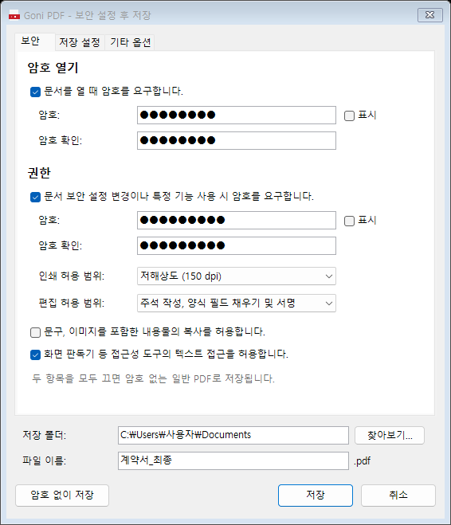
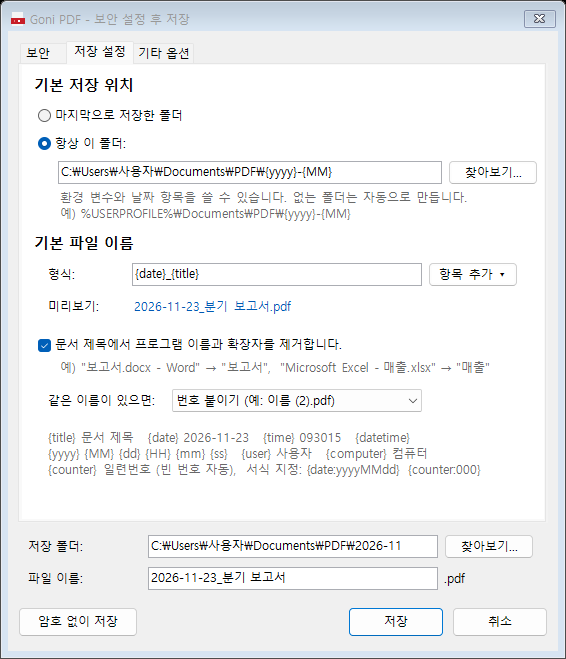
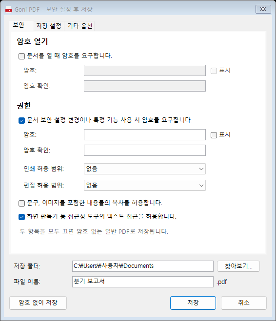
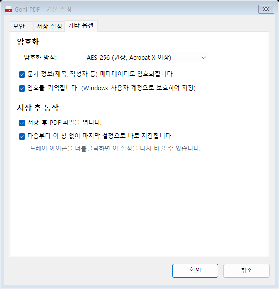

# Goni PDF 가상 프린터

[](https://github.com/turbobit/goni-virtual-printer/releases/latest)
[](LICENSE)


모든 Windows 프로그램에서 **"Goni PDF"** 프린터로 인쇄하면, 열기 암호·권한 암호·인쇄/편집/복사 제한이 걸린 PDF로 저장합니다.
마지막으로 사용한 설정(암호 포함, 선택 시)을 기억하고, 필요하면 **[암호 없이 저장]**으로 일반 PDF도 바로 만들 수 있습니다.
기본 저장 폴더와 파일 이름 형식(`{date}_{title}` 등)을 정할 수 있습니다.

## 스크린샷

| 보안 탭 (열기 암호 + 권한 제한) | 저장 설정 탭 (기본 폴더·파일 이름) |
|---|---|
|  |  |

<details>
<summary>처음 인쇄할 때의 기본 화면 / 트레이 메뉴의 기본 설정 창</summary>




</details>

> 스크린샷은 `tools\screenshots.ps1`로 다시 만들 수 있습니다 (빌드 후 실행).

## 문서

- [사용 설명서](docs/USER_GUIDE.md) — 설치, 인쇄, 설정 항목, 문제 해결
- [설계 문서](docs/ARCHITECTURE.md) — 구조, 작업 흐름, PDF 암호화 구현, 권한 비트

## 구성

```
아무 프로그램 ─인쇄→ [Goni PDF 프린터]
                     드라이버: Microsoft Print To PDF (Windows 내장)
                     포트:     \\.\pipe\GoniPdfPrinter (로컬 포트)
                          │ PDF 바이트
                          ▼
              GoniPdfPrinter.exe (트레이 상주, 로그온 시 자동 실행)
                → 보안 설정 창 → AES 암호화 → 저장
```

- 외부 라이브러리·추가 드라이버 없음. .NET Framework 4.x(Windows 기본 포함)만 필요합니다.
- PDF 암호화는 직접 구현했습니다 (`src/PdfSecurity.cs`).
  - **AES-256** (PDF 2.0 / V5 R6, 기본값, 한글 암호 사용 가능)
  - **AES-128** (V4 R4, 구형 뷰어 호환, 암호는 영문/숫자/기호만)

## 설치 (배포용 설치 프로그램)

[Releases](https://github.com/turbobit/goni-virtual-printer/releases/latest)에서 `GoniPdfPrinterSetup-<버전>.exe`를 내려받아 실행하면 설치 마법사가 진행됩니다 (관리자 권한 필요).
직접 빌드한 경우 설치 파일은 `bin\` 폴더에 생성됩니다.

> 코드 서명이 되어 있지 않아 Windows SmartScreen 경고가 표시될 수 있습니다. *추가 정보 → 실행*을 선택하세요.

- 프로그램 복사, `Goni PDF` 프린터·포트 등록, 로그온 시 자동 실행, 시작 메뉴 바로가기 생성
- 제어판 **앱 및 기능**에서 제거 가능 (프린터·포트도 함께 제거, 사용자 설정은 유지)
- 무인 설치: `GoniPdfPrinterSetup-<버전>.exe /S` / 무인 제거: `"C:\Program Files\GoniPdfPrinter\Uninstall.exe" /S`

## 빌드

```powershell
.\build.ps1 -Version 1.1.0
```

앱(`bin\GoniPdfPrinter.exe`)을 컴파일하고, [NSIS 3](https://nsis.sourceforge.io)이 설치돼 있으면 설치 프로그램(`bin\GoniPdfPrinterSetup-<버전>.exe`)도 만듭니다.
설치 프로그램 정의는 `installer\GoniPdfPrinter.nsi`, 프린터 등록/제거는 `installer\printer.ps1`입니다.

## 개발용 설치 스크립트

```powershell
.\install.ps1
```

`install.ps1`은 관리자 권한을 요청한 뒤 다음을 수행합니다.

1. `C:\Program Files\GoniPdfPrinter\`에 실행 파일 복사
2. 로컬 포트 `\\.\pipe\GoniPdfPrinter` 생성
3. 프린터 `Goni PDF` 추가 (드라이버: Microsoft Print To PDF)
4. 로그온 시 트레이 앱 자동 실행 등록 (HKLM Run)
5. 트레이 앱 실행

제거: `.\uninstall.ps1` (사용자 설정 `%APPDATA%\GoniPdfPrinter`는 남습니다)

## 설정 항목

| 구분 | 항목 | PDF 권한 비트 |
|---|---|---|
| 암호 열기 | 문서를 열 때 암호 요구 | 사용자 암호 |
| 권한 | 보안 설정 변경·기능 사용 시 암호 요구 | 소유자 암호 |
| | 인쇄 허용 범위: 없음 / 저해상도(150 dpi) / 고해상도 | bit 3, 12 |
| | 편집 허용 범위: 없음 / 페이지 삽입·삭제·회전 / 양식 필드 채우기 및 서명 / 주석 작성·양식 필드·서명 / 페이지 추출을 제외한 모든 작업 | bit 4, 6, 9, 11 |
| | 문구·이미지 등 내용 복사 허용 | bit 5 |
| | 화면 판독기 텍스트 접근 허용 | bit 10 |
| 기타 | 암호화 방식 (AES-256 / AES-128) | |
| | 메타데이터(제목·작성자) 암호화 | |
| | 암호 기억 (Windows DPAPI로 현재 사용자 계정에 묶어 저장) | |
| | 저장 후 PDF 열기 | |
| | 다음부터 창 없이 마지막 설정으로 바로 저장 | |
| 저장 설정 | 기본 저장 위치: 마지막으로 저장한 폴더 / 항상 지정한 폴더 | |
| | 기본 파일 이름 형식 (아래 표) + 미리보기 | |
| | 문서 제목에서 프로그램 이름·확장자 제거 | |
| | 같은 이름이 있으면: 번호 붙이기 / 덮어쓰기 / 묻기 | |

- 설정 파일: `%APPDATA%\GoniPdfPrinter\settings.ini` — **저장/확인 시마다 마지막 값이 기록**됩니다.
- 트레이 아이콘 더블클릭(또는 우클릭 → *기본 보안 설정*)으로 언제든 기본값을 바꿀 수 있습니다.
  "창 없이 바로 저장"을 켠 경우 여기서 끄면 됩니다.
- **암호 없이 인쇄**: 설정 창의 **[암호 없이 저장]** 버튼은 이번 문서만 일반 PDF로 저장하고 기억된 보안 설정은 그대로 둡니다.
  항상 암호 없이 저장하려면 보안 탭의 두 항목을 모두 끄세요.

### 파일 이름 형식

| 항목 | 예 (2026-11-23 09:05:07) | 비고 |
|---|---|---|
| `{title}` | 분기 보고서 | 인쇄한 문서 제목. 없으면 `문서` |
| `{date}` / `{time}` / `{datetime}` | 2026-11-23 / 090507 / 2026-11-23_090507 | `{date:yyyyMMdd}`처럼 서식 지정 가능 |
| `{yyyy}` `{yy}` `{MM}` `{dd}` `{HH}` `{mm}` `{ss}` | 2026 26 11 23 09 05 07 | `{MM}`=월, `{mm}`=분 |
| `{user}` / `{computer}` | 사용자 이름 / 컴퓨터 이름 | |
| `{counter}` | 1, 2, 3… | 폴더에 없는 첫 번호. `{counter:000}` → 001 |

예) `{date}_{title}` → `2026-11-23_분기 보고서.pdf`, `스캔_{counter:000}` → `스캔_003.pdf`

기본 폴더에는 환경 변수와 날짜 항목을 쓸 수 있습니다: `%USERPROFILE%\Documents\PDF\{yyyy}-{MM}` (없으면 자동 생성)

**처리하는 엣지 케이스**

- 제목 정리: `보고서.docx - Word`, `Microsoft Excel - 매출.xlsx`, `*제목 없음 - 메모장`, `[호환 모드]`, 전체 경로(`C:\…\계약서.hwp`, UNC), URL(마지막 경로·호스트, % 인코딩 해제)
- 파일명 안전화: 금지 문자(`\ / : * ? " < > |`) → `_`, 제어·방향 제어(RLO)·0폭 문자 제거, 탭/줄바꿈 → 공백, 끝의 점·공백 제거, NFD 한글 → NFC
- 예약 이름(`CON`, `NUL`, `COM1`, `aux.txt` …) 앞에 `_`, 빈 제목·금지 문자만 있는 제목 → `문서`
- 길이: 파일명 150자, 전체 경로 259자 이내로 자동 축약 (이모지 등 서로게이트 쌍을 자르지 않음)
- `.pdf` 중복 방지, 알 수 없는 `{토큰}`과 제목 속 `{…}`은 그대로 유지
- 저장 폴더를 쓸 수 없으면(분리된 USB·네트워크 드라이브 등) 문서 폴더로 저장하고 알림
- 임시 파일에 쓴 뒤 교체하므로 저장 실패 시 기존 파일이 손상되지 않으며, 다른 프로그램에서 연 파일은 안내 후 다시 선택

## 명령줄 (스크립트·테스트용)

```powershell
GoniPdfPrinter.exe encrypt 입력.pdf 출력.pdf --open 열기암호 --owner 권한암호 --print low --edit 3 --copy
```

옵션: `--open`, `--owner`, `--print none|low|high`, `--edit 0~4`, `--copy`, `--no-access`, `--aes128`, `--no-meta`

파일 이름 규칙 확인:

```powershell
GoniPdfPrinter.exe name --title "분기 보고서.docx - Word" --pattern "{date}_{title}" --folder "%USERPROFILE%\Documents\PDF"
```

옵션: `--title`, `--pattern`, `--folder`(지정 시 최종 경로 출력), `--now 2026-11-23T09:05:07`, `--keep-app`, `--conflict number|overwrite|ask`

기타: `GoniPdfPrinter.exe --settings` (설정 창), `GoniPdfPrinter.exe --test-job 파일.pdf` (프린터 없이 인쇄 작업 흉내)

## 테스트

```powershell
python -X utf8 tests\verify_encryption.py
```

```powershell
python -X utf8 tests\test_filenames.py
```

- `verify_encryption.py`: PyMuPDF(`pip install pymupdf`)로 AES-256/128, 한글 암호, 권한 비트, 객체 스트림 PDF, 이미 암호화된 파일 거부를 검증합니다.
- `test_filenames.py`: 파일 이름·폴더 규칙의 엣지 케이스 53가지를 검증합니다.

## 참고 / 제한

- 트레이 앱이 실행 중이어야 인쇄가 처리됩니다. 꺼져 있으면 인쇄 작업이 대기열에 "오류"로 남으며, 앱을 실행한 뒤 작업을 *다시 시작*하면 됩니다.
- 권한 제한은 PDF 표준 방식으로, Acrobat·Edge·Chrome 등 표준을 지키는 뷰어에서 적용됩니다. 열기 암호와 달리 권한 제한은 이를 무시하는 도구로는 우회될 수 있습니다.
- Windows "보호된 인쇄 모드(Windows protected print mode)"가 켜진 PC에서는 사용자 지정 포트 프린터 추가가 제한될 수 있습니다.

## 소스 구조

| 파일 | 내용 |
|---|---|
| `src/Program.cs` | 진입점, 트레이 앱, 파이프 수신기, 작업 처리, CLI |
| `src/SecurityForm.cs` | 설정 창 (보안 / 저장 설정 / 기타 옵션 탭, 암호 없이 저장) |
| `src/FileNaming.cs` | 파일 이름 형식 전개, 제목 정리, 파일명·폴더 검증, 중복 처리, 안전한 저장 |
| `src/AppSettings.cs` | 설정 저장/복원 (DPAPI 암호 보호) |
| `src/PdfModel.cs` | PDF 파서 (xref 테이블/스트림, 객체 스트림, 손상 복구) |
| `src/PdfSecurity.cs` | 권한 비트, AES-256(R6)/AES-128(R4) 보안 처리기, 암호화 PDF 작성기 |
| `installer/GoniPdfPrinter.nsi` | NSIS 설치 프로그램 정의 |
| `installer/printer.ps1` | 프린터·포트 등록/제거 (설치 프로그램에서 호출) |
| `tools/screenshots.ps1` | README 스크린샷 생성 |
| `tests/verify_encryption.py` | 암호화 결과 검증 |
| `tests/test_filenames.py` | 파일 이름·폴더 규칙 엣지 케이스 검증 |

## 라이선스

[MIT](LICENSE)
